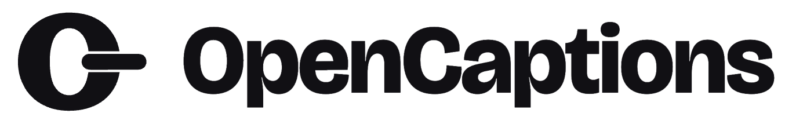
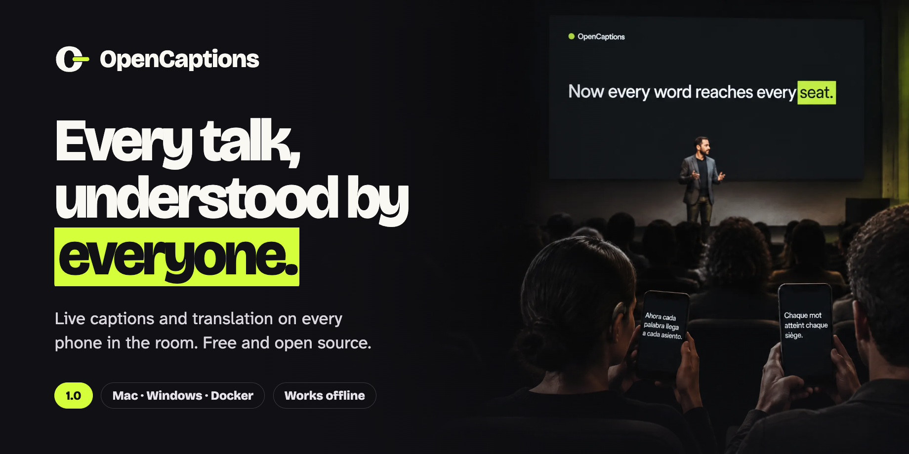
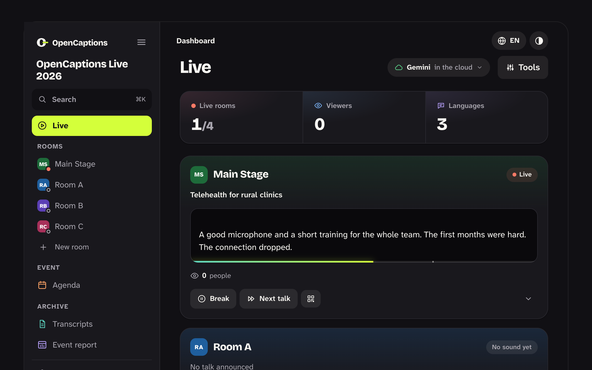
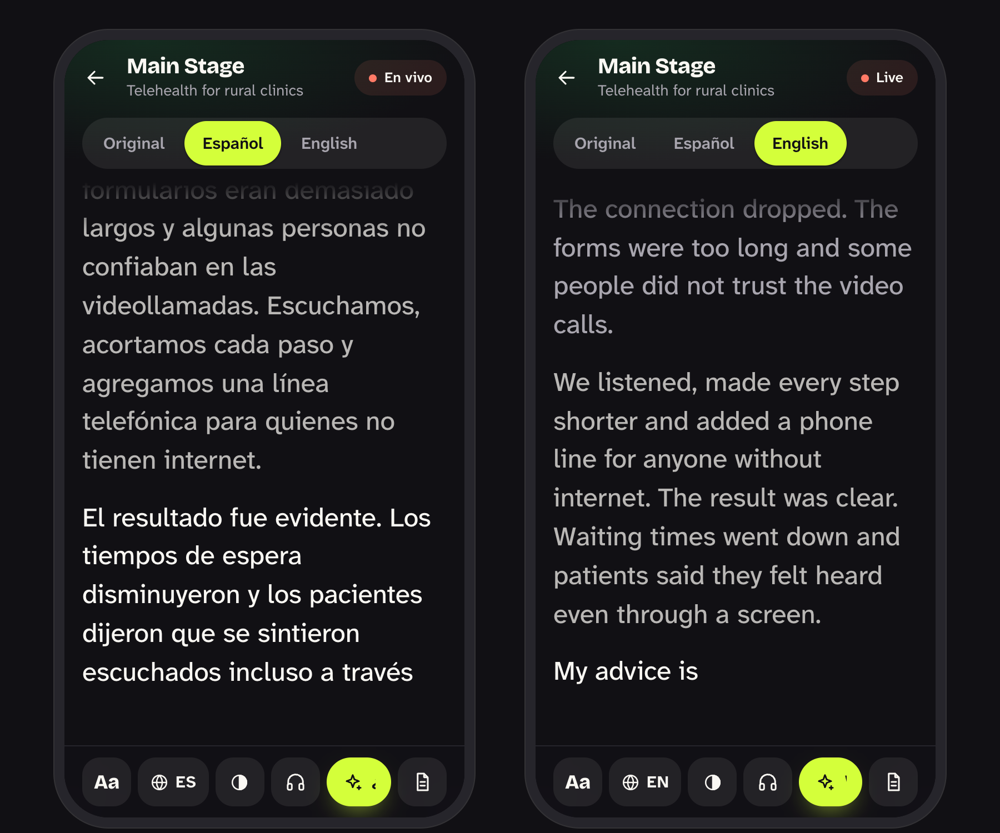
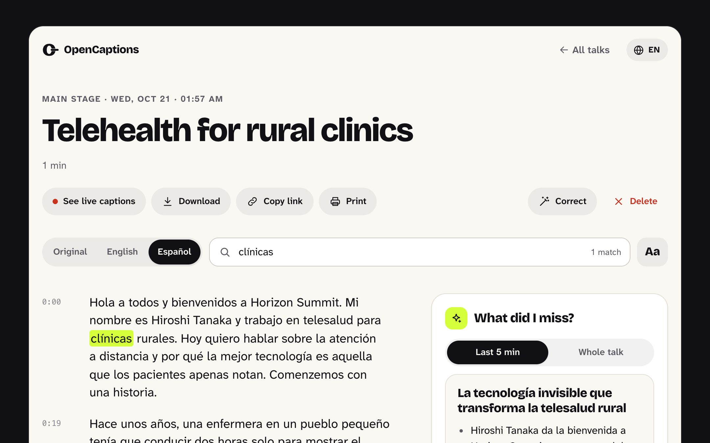
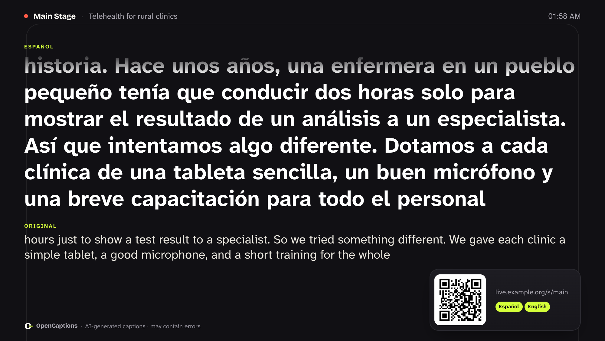
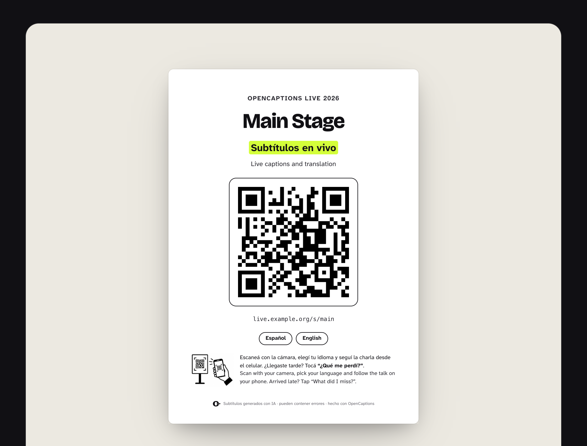
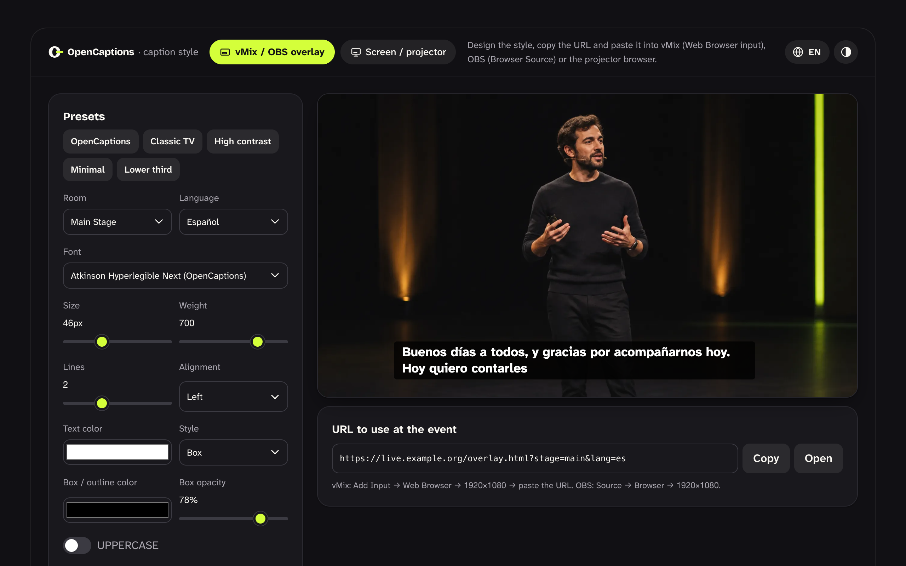
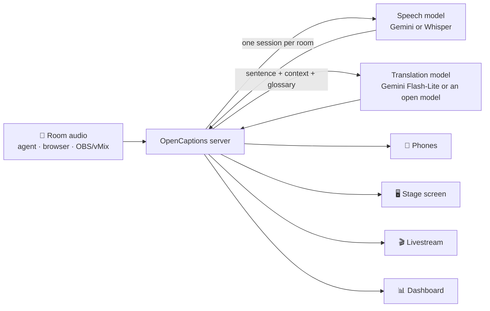

<div align="center">

<picture>
  <source media="(prefers-color-scheme: dark)" srcset="docs/images/logo-lockup-dark.png" />
  
</picture>

### Every talk, understood by everyone.

Live captions and translation for conferences, classrooms, town halls and any event with a microphone.<br>
On every phone, on the big screen and in your livestream. Free and open source.

[](https://github.com/carraroesteban/opencaptions/releases/latest)
[](https://github.com/carraroesteban/opencaptions/actions/workflows/ci.yml)
[](LICENSE)
[](docs/requirements.md)
[](#on-a-server-docker-a-vps-or-the-cloud)

**[Try it live on your phone](https://try-opencaptions.kvza.ar/s/main)** (nothing to install) · [Website](https://opencaptions.kvza.ar) · [30-second demo](https://opencaptions.kvza.ar/#screens) · [Download](#quick-start) · [Features](#features) · [Pricing](#what-it-costs) · [Docs](#documentation) · [En español](#en-español)



</div>

---

Someone speaks into a microphone. A few seconds later, everyone in the room can read it **in their own language**: on their phone, on the screen next to the stage, and in the livestream. People who arrive late catch up with one tap. When the session ends, the full transcript is ready to read, search and share.

- **For the audience:** scan the room's QR code, pick a language. No app, no sign-up.
- **For the organizer:** one dashboard for every room. Rooms run by themselves: they pause in silence, resume when someone speaks and take talk titles from your agenda.
- **Yours to own:** MIT-licensed, runs on your own computer or server, no accounts, no per-seat licenses, no tracking.
- **Your choice of AI:** Google Gemini for the best quality, or run everything on your own computer. **Run it on your own computer and nothing leaves it: no audio uploaded, nothing billed per minute.** (With Gemini, the audio goes to Google.)

Not running an event? Choose **Just for me** the first time you open the app, and OpenCaptions captions whatever you're listening to on your own computer (a video call in another language, a class, a video), translated if you like, in a small window that floats over everything. [How it works](docs/personal.md).

## Screenshots

| Production dashboard | On the audience's phone | Transcript, search and summary |
|---|---|---|
|  |  |  |
| **Stage screen** | **QR poster** | **Caption style editor** |
|  |  |  |

<sub>Shown in demo mode, which uses the same interface with simulated captions.</sub>

## Quick start

<a name="without-the-terminal"></a>

### Download the app

**[⬇ OpenCaptions for Mac](https://github.com/carraroesteban/opencaptions/releases/latest/download/OpenCaptions-mac.zip)** · **[⬇ OpenCaptions for Windows](https://github.com/carraroesteban/opencaptions/releases/latest/download/OpenCaptions-windows.zip)**

1. **Mac:** unzip it, drag **OpenCaptions** to Applications and open it. **Windows:** extract the ZIP and double-click **Start OpenCaptions**.
2. The first time, it installs what it needs (about a minute, and Node.js too if this computer doesn't have it), then opens the dashboard in your browser.
3. The welcome wizard asks for the event name, rooms and languages, connects Gemini with your API key ([free from Google AI Studio](https://aistudio.google.com/apikey)), and can create a public HTTPS address for the QR codes with one click.

A small OpenCaptions window shows it running: keep it open during the event, and quit it to stop. Your settings and transcripts are kept outside the app, so they survive updates.

No Gemini key, or your free key ran out mid-event? Click **Use this computer (free, slower)** in the wizard, on the **Just for me** page or on the dashboard's banner. It downloads a free speech model once (nothing to download on a Mac with macOS 26) and captions start, with no terminal. [Local mode](docs/local.md#without-a-terminal-one-button).

<details>
<summary>The computer warns about the app the first time</summary>

The apps aren't signed with a paid Apple or Microsoft certificate yet, so the first launch asks you to confirm, once. [Step by step, in English and Spanish](docs/first-launch.md).

- **Mac, "Apple could not verify…":** click **Done**, then open **System Settings → Privacy & Security**, scroll down and click **Open Anyway** next to OpenCaptions.
- **Windows, "Windows protected your PC":** click **More info → Run anyway**. If an antivirus blocks the launcher, open the `app` folder and double-click `Start OpenCaptions.bat`.

</details>

### Updates

OpenCaptions updates itself from inside the app, like Zoom: click **Update now** on the dashboard's line when a new version is out, or choose **Check for Updates…** in the app's menu (on a Mac, the **OpenCaptions** menu; on Windows, the OpenCaptions icon in the taskbar's notification area). It shows what's new, and **Update and Restart** downloads the new version and restarts it in about a minute; your settings, rooms and transcripts stay. The dashboard also shows one quiet line when a new version is out. Nothing is installed until you click. [How updates work](docs/deployment.md#updates).

### On a server: Docker, a VPS or the cloud

```bash
docker run -d --pull always --name opencaptions --restart unless-stopped -p 127.0.0.1:8080:8080 -v opencaptions-data:/app/data -v opencaptions-config:/app/config ghcr.io/carraroesteban/opencaptions
docker logs opencaptions | grep "Open the dashboard"
```

The second command prints a link that opens the dashboard already signed in (it works once, within 30 minutes; restart the container for a new one). The wizard does the rest, API key and public address included. The passwords are in **Settings → Security**, never in the logs.

[](https://render.com/deploy?repo=https://github.com/carraroesteban/opencaptions)

Docker Compose, a Linux service, Render, Fly.io, Railway and a cloud VM: [Deployment](docs/deployment.md).

### For developers

See it working in two minutes, **no API key needed** (captions are simulated):

```bash
git clone https://github.com/carraroesteban/opencaptions.git
cd opencaptions
npm install
npm run mock                                              # http://localhost:8080
npm run feed -- --stage main --input samples/talk-en.wav  # in a second terminal: play a sample talk into the room
```

For real captions, paste a Gemini key in **Settings → AI**, or `npm run setup`, then `npm run check` (a 25-second end-to-end test) and `npm start`. Everything on your own machine instead: `npm run local` ([Local mode](docs/local.md)). The full walkthrough is in [Getting started](docs/getting-started.md); the code is explained in [Architecture](docs/architecture.md).

**What you need:** one computer or small server for the whole event (macOS, Linux or Windows; with Gemini, one CPU core and 1 GB of RAM are enough for 20 rooms or more), outbound internet on port 443 (no inbound ports), and a Gemini API key or [local mode](docs/local.md). Details: [Requirements](docs/requirements.md).

## Features

**For your audience**

- **Captions on any phone**, in any of 82 languages, smooth to read: words appear at the speaker's pace and lines roll up like TV captions.
- **The slide, on their phone, in their language:** the speaker's computer shares the presentation and each new slide arrives translated. [Accessibility](docs/accessibility.md#the-slide-on-the-phone-in-your-language)
- **Tap any word** to have it explained in plain words, from what the speaker said.
- **What did I miss?** A summary of the last five minutes, or the whole session. **Ask the talk:** questions answered only from what was said. **Ask the whole event:** one question across every room and talk, with links to the moment.
- **Listen:** the translation read aloud in headphones, or the room's own sound for hearing aids and cochlear implants, when the organizer turns it on. [Accessibility](docs/accessibility.md)
- **Transcripts** to read, search, print and download (TXT, SRT, VTT), with who said what; each talk's page opens with its chapters and key quotes, ready to share.

**For the stage and the stream**

- **A stage screen** with big captions and the room's QR code; a **livestream overlay** for OBS and vMix, in one or two languages.
- **Any audio source:** the sound desk through a computer, a browser tab, or OBS/vMix streaming to the server (RTMP, SRT, HLS).
- **Speakers who switch languages** mid-sentence: every caption language follows.
- **Captions inside Zoom, YouTube Live and Microsoft Teams**, and webhooks for anything else. [Integrations](docs/integrations.md)

**For organizers**

- **Try it live in a browser** with nothing to install ([demo](https://try-opencaptions.kvza.ar/s/main)), and **one phone can run a room** at a meetup with no sound desk.
- **Guided setup**, agenda import (Sessionize, Swapcard, any spreadsheet or a calendar link) and printable **QR posters**.
- **A production dashboard** with every room's sound, delay, audience, cost and alerts, plus **alerts on your phone** (ntfy, Telegram, Slack, Discord).
- **Safe on the day:** Event mode locks the setup, every change can be undone, a backup computer takes over a room's sound, and if the internet drops, captions move to your laptop and come back by themselves.
- **Fix a caption live** and it changes on every screen; a **glossary** spells names and brands right.
- **Caption a recording** in minutes, an **event report** for sponsors, and every transcript in one .zip.
- **Any AI for translations:** Gemini, or OpenAI, OpenRouter, Groq, Mistral or any OpenAI-compatible service. [How](docs/reference/configuration.md#use-another-ai-for-translations)

Everything, with its status: [Project overview](docs/overview.md).

## How it works

<picture>
  <source media="(prefers-color-scheme: dark)" srcset="docs/images/diagrams/how-it-works-dark.png" />
  
</picture>

<details><summary>Text version of this diagram</summary>



</details>

A speech model transcribes each room continuously; each sentence is translated with the previous ones and your glossary as context. Captions typically appear a few seconds after the words are spoken ([where the time goes](docs/latency.md)). Internals: [Architecture](docs/architecture.md) and the [design decisions](docs/adr/).

## What it costs

**The software is free.** You only pay for the AI you choose to use.

| | OpenCaptions, cloud (Gemini) | OpenCaptions, your computer | Human captioner |
|---|---|---|---|
| Price per room-hour | About **US$ 0.54**, +US$ 0.4–0.6 per extra language | **Free** | US$ 90–300 |
| Needs internet | Yes | No | If remote |
| Accuracy · delay | Good · 2–3 s | Good · a few seconds more | Highest |
| Audio goes to | Google | Nowhere | The captioner |
| App for attendees | None: a QR code | None: a QR code | Depends on the service |
| Languages | Several at once | Several at once | One per captioner |

Silence is never billed; a translated voice in headphones (🎧) brings Gemini to about US$ 2.2. On your own computer, plan on about one room per laptop. More options compared: [the website](https://opencaptions.kvza.ar/alternatives/).

For example, a 40-minute talk captioned from English into Spanish costs about **US$ 0.70** with Gemini. The dashboard shows a running cost estimate for every room.

## Privacy and security

- **Self-hosted:** transcripts stay on your computer or server. Audio is never written to disk.
- **With Gemini, the room's audio goes to Google.** On the free tier Google may use it to improve its products; for events with personal information, use a paid key or Vertex AI. In local mode, nothing leaves the computer.
- **No telemetry.** Once a day OpenCaptions asks GitHub whether a new version is out, sending nothing about you or the event; turn it off in **Settings → System → New versions** or with `UPDATE_CHECK=0`.
- **Signed-in dashboard** with an admin and a crew role, two-factor codes and company sign-in; no inbound ports needed.

Exactly what leaves the machine, and when: [Privacy and data](docs/privacy.md). Hardening: [Security guide](docs/security-guide.md). What to tell speakers and the audience: [Licenses and responsibilities](docs/legal.md).

## Documentation

All the docs, by who you are: **[docs/README.md](docs/README.md)**.

- **Trying it out:** [Getting started](docs/getting-started.md) · [FAQ](docs/faq.md)
- **On the day:** [Checklist](docs/operations/day-of-event.md) · [Troubleshooting](docs/operations/troubleshooting.md)
- **On a server:** [Deployment](docs/deployment.md) · [Security](docs/security-guide.md)
- **Developers:** [Architecture](docs/architecture.md) · [API](docs/reference/api.md) · [Changelog](CHANGELOG.md)

## Current limitations

- Gemini's live speech models are previews; their behavior and quotas may change.
- Accuracy with strong accents or very rapid language switching depends on the model. The glossary and pinning a room's language help.
- Voices aren't told apart; transcripts name the speaker the agenda lists for each talk.
- The Mac app and Windows launcher aren't signed yet, so the first launch shows a warning to confirm.
- In local mode a laptop handles about one room, and captions run a few seconds further behind than with Gemini.

## En español

**OpenCaptions** lleva subtítulos y traducción en vivo a cualquier evento: congresos, universidades, iglesias, sesiones públicas, eventos corporativos y festivales. Es gratis, open source (MIT) y corre en tu propia computadora o servidor.

- **El público** escanea el QR, elige su idioma y sigue la charla en el celular. Si llegó tarde, toca **¿Qué me perdí?**. Quien usa audífonos o un implante puede escuchar el sonido de la sala en su celular. Al final, la transcripción queda para leer, buscar y descargar.
- **En el escenario**, una pantalla con subtítulos grandes junto al orador y un overlay para OBS o vMix, en uno o dos idiomas.
- **Para la organización**, un panel con el estado, la demora, el público y el costo de cada sala. Las salas funcionan solas y toman los títulos de la agenda. Para traducir podés usar Gemini u otra IA (OpenAI, OpenRouter, Groq, Mistral).
- **Costo:** el software es gratis. Con Gemini, unos US$ 0,54 por hora de charla por sala (US$ 2,2 con voz traducida en auriculares; el silencio no se cobra). En modo local, nada: corre en tu propia computadora, no se sube audio y no se cobra por minuto.

**Para empezar sin terminal:**

1. Descargá [OpenCaptions para Mac](https://github.com/carraroesteban/opencaptions/releases/latest/download/OpenCaptions-mac.zip) o [para Windows](https://github.com/carraroesteban/opencaptions/releases/latest/download/OpenCaptions-windows.zip). En Mac, arrastrá OpenCaptions a Aplicaciones y abrilo; en Windows, descomprimí el ZIP y hacé doble clic en **Start OpenCaptions**. Si la computadora te avisa que no puede verificar la app: [paso a paso](docs/first-launch.md#en-español).
2. El asistente pregunta el nombre del evento, las salas y los idiomas, conecta Gemini con tu API key y crea una dirección pública con HTTPS en un clic.
3. ¿Sin key, o tu key gratis se quedó sin cuota en pleno evento? Hacé clic en **Usar esta computadora (gratis, más lento)**.

Para actualizar, hacé clic en **Actualizar ahora** en el panel cuando sale una versión nueva (o **Buscar actualizaciones…** en el menú de la app): se descarga y se reinicia en cerca de un minuto, sin perder ajustes ni transcripciones.

En un servidor, con Docker: el mismo comando de [arriba](#on-a-server-docker-a-vps-or-the-cloud). Guía para el día del evento: [event-day.es.md](docs/operations/event-day.es.md).

## Contributing

Issues and pull requests are welcome. See [CONTRIBUTING.md](.github/CONTRIBUTING.md) for the development setup, tests and documentation style, and the [Code of Conduct](.github/CODE_OF_CONDUCT.md). Please report vulnerabilities privately: [SECURITY.md](.github/SECURITY.md).

## License

[MIT](LICENSE): free for any event, commercial or not.
