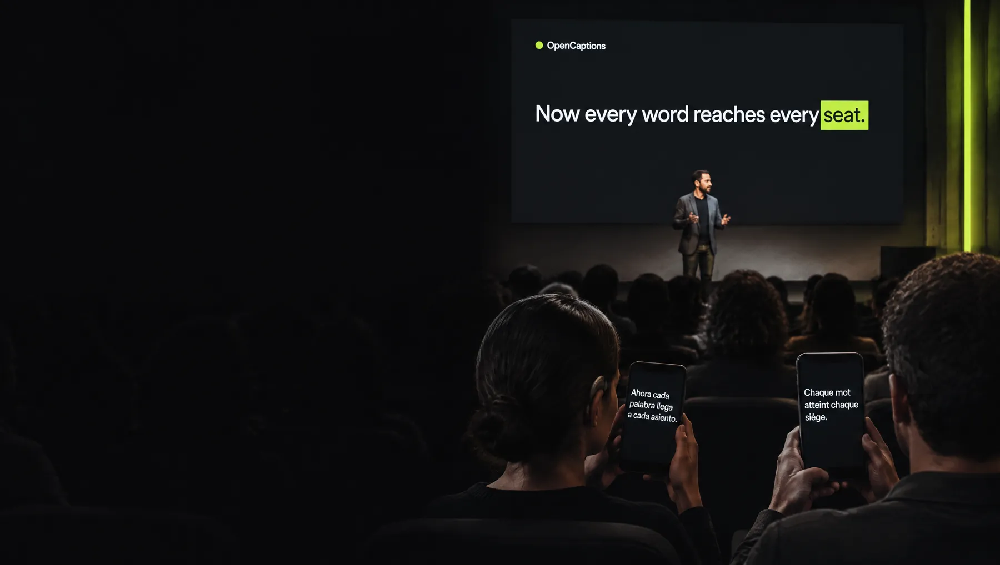

# OpenCaptions documentation

OpenCaptions is free, open-source software for live captions and translation at any event, from one room to many at the same time. Find yourself below and start at the top of your list.

## Organizers: trying it out and planning an event

| Page | Read it when you want to… |
|---|---|
| [Project overview](overview.md) | Understand in one page what OpenCaptions does, what's tested and what's next. |
| [FAQ](faq.md) | Get quick answers: cost, languages, accuracy, updates, privacy. |
| [Opening it the first time](first-launch.md) | Get past the Mac or Windows warning on the first launch (English and Spanish). |
| [Getting started](getting-started.md) | See captions and translations working on your computer in about 10 minutes. |
| [Privacy and data](privacy.md) | Know exactly what leaves the computer, and when. |
| [Licenses and responsibilities](legal.md) | Know what to tell speakers and the audience, with a ready-made notice. |
| [Integrations](integrations.md) | Send captions into Zoom, YouTube Live, Microsoft Teams or a webhook; import the agenda from Sessionize or a calendar. |
| [Caption a recording](recording.md) | Turn an audio or video file into a transcript and subtitles. |
| [Accessibility](accessibility.md) | What the audience can adjust, the room's sound for hearing aids, and what's checked (WCAG 2.2 AA). |
| [Just for me](personal.md) | Caption your own calls, videos and conversations on your computer. |

## Crew on the day

| Page | Read it when you want to… |
|---|---|
| [Day-of-event checklist](operations/day-of-event.md) | One page to print: before doors open, each room's sound check, during talks, end of day. |
| [Event-day runbook](operations/runbook.md) | The full guide, from the day before to the end of the event, with every alert explained. |
| [Troubleshooting](operations/troubleshooting.md) | Fix a specific symptom quickly, starting with "no captions at all". |
| [Guía del día del evento](operations/event-day.es.md) | Hand the crew a checklist in Spanish. |

## IT and self-hosting

| Page | Read it when you want to… |
|---|---|
| [Requirements](requirements.md) | Check operating systems, hardware, network and accounts. |
| [Deployment](deployment.md) | Choose between a venue computer and a cloud server, then install with the app, Docker, Node.js or a system service; updates and backups. |
| [Upgrading](upgrading.md) | Update any kind of install, and what changes in 0.9.2. |
| [Networking](networking.md) | Know which ports and domains are used, and what to do when the venue network blocks something. |
| [Security guide](security-guide.md) | The threat model, who can see what, and the hardening checklist. |
| [Local mode](local.md) | Run speech recognition and translation on your own computer: no API key, no internet, no cost per hour; and the offline backup. |
| [Latency](latency.md) | Where the seconds go, and how to tune for less delay. |
| [Configuration reference](reference/configuration.md) | Every environment variable, `config/event.json`, the glossary, the agenda file and the command-line tools. |

## Developers

| Page | Read it when you want to… |
|---|---|
| [Architecture](architecture.md) | Components, data flow, failure handling and how it scales. |
| [API reference](reference/api.md) | HTTP endpoints, WebSocket protocols, metrics and page URLs. |
| [Architecture decision records](adr/README.md) | Why the main technical choices were made, and what they cost. |
| [Glossary](../GLOSSARY.md) | The one word to use for each idea (room, talk, crew, original…) in code, docs and the app. |
| [Brand and design system](brand.md) | Logo files, colors, type, light/dark tokens, motion and the website. |
| [How Apple's Live Translation works](research/apple-live-translation.md) | Research behind local mode on a Mac. |
| [Contributing guide](../.github/CONTRIBUTING.md) | Dev setup, tests, commit style and documentation standards. |
| [Security policy](../.github/SECURITY.md) | How to report a vulnerability privately. |
| [Changelog](../CHANGELOG.md) | User-visible changes per release. |

## Conventions used in these docs

- Commands are shown for macOS and Linux shells. Windows PowerShell equivalents are given where they differ.
- `<angle brackets>` mark values you replace, such as `<room-id>`.
- A **room** is the same thing as a **stage** in the code and API (`stage` is the identifier used in URLs).
- **Venue PC** or **room computer** means the computer in a room that receives audio from the sound desk.
- Some dashboard pages (Glossary, Integrations, History) and settings show only in **Advanced mode**, switched at the bottom of the sidebar.
