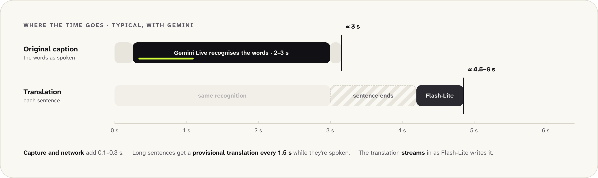

# Brand and design system

How OpenCaptions looks, and where each piece lives. Every page (the app, the overlay and the [website](https://opencaptions.kvza.ar)) uses the same design tokens, so change a color or font in one place.

## Logo: the "Open O"

An open ring with a caption line coming out of it. The approved files are in [`public/brand/`](../public/brand/). Don't redraw them: the other files there reuse their paths unchanged.

| File | Use |
|---|---|
| `logo-ink.svg` | Light backgrounds: everything in ink. |
| `logo-dark.svg` | Dark backgrounds: paper O, lime line. |
| `logo-original.svg` | The source file as delivered (lime line on paper). Kept for reference; **don't use it on screen**, because lime on paper breaks the color rule. |
| `mark-ink.svg`, `mark-dark.svg` | The same two, cropped to the artwork. The `.brand` wordmark uses these. |
| `sprite.svg` | The O and the line as symbols, for inline SVG that follows the theme and animates (`.oc-logo`). |
| `icon.svg`, `maskable.svg`, `avatar.svg` | App icon, favicon, maskable icon and avatars: ink O on a lime tile. |
| `icon-192.png`, `icon-512.png`, `maskable-512.png`, `avatar-512.png`, `../favicon.ico`, `../apple-touch-icon.png` | Rasterized from the SVGs above. |
| `og.png` | Link preview (1200×630). |
| `../../deploy/desktop/icon-macos.svg`, `OpenCaptions.icns`, `OpenCaptions.ico` | The desktop apps' icons: the app icon on Apple's grid (824 px with a soft shadow, as macOS expects) and full-bleed for Windows. Rebuilt with `npm run icons` on a Mac. |
| `../../docs/images/social-preview.png` | GitHub social preview (1280×640). Upload it in the repository's **Settings → General → Social preview**. |

The wordmark is **OpenCaptions** in Inter 500 (`.brand` in `style.css`).

## Color

The pages are black and white: near-white and near-black backgrounds (`--bg`, `--fg`), grey secondary text (`--fg2`), and hairlines (`--line`) to separate things rather than heavy fills or shadows. Buttons are pills with a hairline border; the one primary action of a screen, and a selected pill, is solid black on light and white on dark (`--primary-bg`). Icons and categories are quiet greys (the `--c-*` hues only differ in the high-contrast theme).

The brand palette:

| Token | Value | Role |
|---|---|---|
| `--ink` | `#111014` | The logo and the focus ring on light; text on lime; the projector's background |
| `--paper` | `#FAF8F3` | The logo's O on dark; text on the projector |
| `--lime` | `#D4FF3A` | Small accents only: the logo's line on dark, dots, the highlighter, the focus ring in dark mode |
| `--graphite` | `#2B2A31` | Second-language lines on light (the overlay with dark captions, the QR posters) |
| `--fog` | `#E8E5DD` | Second-language lines on dark (the projector, the overlay) |

**The rule:** lime only on ink, or ink on lime. Never lime on paper, and never lime as text on a light background. In the code lime is either a *fill* with ink on top (the highlighter on search hits and selected text, the assistant's sparkle badge) or a small mark on a dark surface. Buttons are never lime. When you need an emphasis color for text or a stroke, use `--accent-fg` (ink in light mode, lime in dark mode).

Status colors (`--ok`, `--warn`, `--bad`) are tuned so text in them stays readable (WCAG 2.2 AA, 4.5:1) on every surface of both themes; `npm run a11y` checks it.

Translation lines are a muted tone, never a second accent color: Fog on the projector's second band and the overlay's second language (Graphite when the overlay's captions are dark), and the `--translation` token on the app's pages (the original under a translation).

An event can set its own highlight color with `accent` in `config/event.json`. Text on it switches between ink and paper automatically for contrast.

## Type

- **Inter**: the whole interface, headlines and the wordmark included (`--font-display` and `--font`). Headlines are light (300; small titles 450), text 400 and labels 500. Labels and buttons are in sentence case.
- **Atkinson Hyperlegible Next 400/700**: the default caption font on the projector and the stream overlay (`--cap-font`; the style editor offers the others). On phones, captions use Inter, or Atkinson Hyperlegible or Lexend from the reader's **Aa** settings.

They are served by OpenCaptions itself from `public/fonts/` (downloaded once with their licenses by `scripts/fetch-fonts.js`), so no page contacts Google and they work on a venue network without internet. The optional caption fonts in the style editor are served the same way. Bricolage Grotesque, the earlier headline font, is still there for the titles of the social video (`scripts/compose-social.js`); no page uses it.

## Light and dark

[`public/tokens.css`](../public/tokens.css) defines every semantic token (`--bg`, `--fg`, `--line`, `--primary-bg`…) for light, dark and high contrast. Every page, the website included, follows the device's setting (`prefers-color-scheme`) until the viewer picks a theme: the theme button next to the language on the app's pages (Like the system, Light, Dark or High contrast), or ◐ on the website. The choice sets `data-theme` on `<html>`. Two pages ignore it: the projector screen is always dark, and the overlay always stays transparent.

## Motion

- **The newest word fades in** (`.live-word`, set by `liveText()` / `liveHtml()` in `common.js` and by the roll-up in `smooth.js`), once, in 0.2 s. Captions don't use the highlighter: words arrive one at a time, and a lime block hopping from word to word three times a second read as "still thinking" and pulled the eye away from the text. The highlighter stays for search hits and selected text.
- **The caption line types out of the O** (`.oc-logo.typing` loops, as on the phone's waiting screen; `.oc-logo.typed` plays once, as on the setup wizard's first screen).
- **A live dot blinks** quietly, with no glow ring.

Both are turned off for people who ask for reduced motion.

## Illustrations

There are no generated pictures. The one visual is drawn in code: **the lines** (`public/lines.js`), a field of fine horizontal lines that bend in the middle with a speech-like rhythm, in the page's own text colour so it follows light and dark. It fills the website's first screen and download panel, the setup wizard and the audience home (unless the event uploads its own picture). It stands still for people who ask for reduced motion, pauses off screen, and the website has a pause button.

Everything else is the product itself: the website draws the phone, the dashboard, the projector screen and the overlay in HTML, with captions typing in. The setup's two choices and the QR poster's scan icon are simple line drawings (inline SVG).

The product demo (`site/media/demo.mp4`) is not generated: `npm run demo:record` films the real stage screen and a phone while the server captions a sample talk, with the AI replayed from the end-to-end test's recording.

## Diagrams in the docs

The technical diagrams in these docs are drawn in the same style: paper and ink, the server as the one dark block (lime in dark mode), AI models with a dashed border, and lime only on dark screens. Each one has a light and a dark version, and GitHub shows the one that matches the reader's theme:

```html
<picture>
  <source media="(prefers-color-scheme: dark)" srcset="images/diagrams/latency-dark.png" />
  
</picture>
```

The sources are small HTML pages in [`docs/diagrams/`](diagrams/) that share `diagram.css` (the look) and `diagram.js` (icons and the arrows between boxes). To change one, edit its HTML and run `npm run docs:images` (or `npm run docs:images -- latency` for just that one); it needs Chrome. Below each diagram, a collapsed *Text version* keeps the Mermaid description for screen readers and plain-text readers: update it too.

## Where things live

| Path | What |
|---|---|
| `public/tokens.css` | Palette, fonts and semantic tokens (light + dark). |
| `public/style.css` | Shared components: buttons, pills, chips, cards, sheets, logo, highlighter, the sign-in and Settings panels, and small `u-*` utilities. Pages use no `style=""` attributes: the Content-Security-Policy refuses them, so a one-off adjustment is a utility class. |
| `public/pip.css` | The floating (picture-in-picture) caption and status windows. |
| `public/illustrations.js` | Small inline SVG illustrations and the button icon set (`icon()`, `mountIcons()`). |
| `public/lines.js` | The lines wallpaper (a `<canvas class="lines">`), shared by the app and the website. |
| `docs/diagrams/` | Sources of the documentation diagrams; `npm run docs:images` renders them to `docs/images/diagrams/`. |
| `site/` | The landing page (EN at `/`, ES at `/es/`). `npm run site` copies the tokens, styles, brand assets and screenshots next to it and serves it on port 8081. The `Site` workflow deploys it to GitHub Pages at opencaptions.kvza.ar. |
