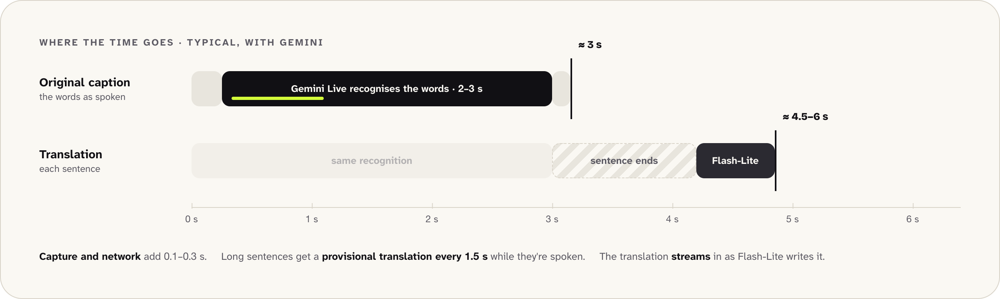

# Brand and design system

How OpenCaptions looks, and where each piece lives. Every page (the app, the overlay and the [website](https://opencaptions.kvza.ar)) uses the same design tokens, so change a color or font in one place.

## Logo: the "Open O"

An open ring with a caption line coming out of it. The approved files are in [`public/brand/`](../public/brand/). Don't redraw them: the other files there reuse their paths unchanged.

| File | Use |
|---|---|
| `logo-ink.svg` | Light backgrounds: everything in ink. |
| `logo-dark.svg` | Dark backgrounds: paper O, lime line. |
| `logo-original.svg` | The source file as delivered (lime line on paper). Kept for reference; **don't use it on screen**, because lime on paper breaks the color rule. |
| `mark-ink.svg`, `mark-dark.svg` | The same two, cropped to the artwork. The `.brand` wordmark uses these. |
| `sprite.svg` | The O and the line as symbols, for inline SVG that follows the theme and animates (`.oc-logo`). |
| `icon.svg`, `maskable.svg`, `avatar.svg` | App icon, favicon, maskable icon and avatars: ink O on a lime tile. |
| `icon-192.png`, `icon-512.png`, `maskable-512.png`, `avatar-512.png`, `../favicon.ico`, `../apple-touch-icon.png` | Rasterized from the SVGs above. |
| `og.png` | Link preview (1200×630). |
| `../../deploy/desktop/icon-macos.svg`, `OpenCaptions.icns`, `OpenCaptions.ico` | The desktop apps' icons: the app icon on Apple's grid (824 px with a soft shadow, as macOS expects) and full-bleed for Windows. Rebuilt with `npm run icons` on a Mac. |
| `../../docs/images/social-preview.png` | GitHub social preview (1280×640). Upload it in the repository's **Settings → General → Social preview**. |

The wordmark is **OpenCaptions** in Bricolage Grotesque 800.

## Color

| Token | Value | Role |
|---|---|---|
| `--ink` | `#111014` | Text on light, dark background |
| `--paper` | `#FAF8F3` | Light background, text on dark |
| `--lime` | `#D4FF3A` | Highlight. At most ~10% of any screen |
| `--graphite` | `#2B2A31` | Dark surfaces; translation lines on light |
| `--fog` | `#E8E5DD` | Light surfaces; translation lines on dark |

**The rule:** lime only on ink, or ink on lime. Never lime on paper, and never lime as text on a light background. In the code this means lime is always a *fill* (highlighter, selected pill, primary button in dark mode) with ink on top. When you need an emphasis color for text or a stroke, use `--accent-fg` (ink in light mode, lime in dark mode).

Status colors (`--ok`, `--warn`, `--bad`) are tuned so text in them stays readable (WCAG 2.2 AA, 4.5:1) on every surface of both themes; `npm run a11y` checks it.

Translation lines (the second language in the overlay, the original under a translation, the projector's second band) use the muted `--translation` token: Fog on dark, Graphite on light. Never a second accent color.

An event can set its own highlight color with `accent` in `config/event.json`. Text on it switches between ink and paper automatically for contrast.

## Type

- **Bricolage Grotesque 800**: headlines and the wordmark (`--font-display`).
- **Atkinson Hyperlegible Next 400/700**: body, UI and captions (`--font`). It's also the default caption font in the overlay and the projector.

Both are served by OpenCaptions itself from `public/fonts/` (downloaded once with their licenses by `scripts/fetch-fonts.js`), so no page contacts Google and they work on a venue network without internet. The optional caption fonts in the style editor are served the same way.

## Light and dark

[`public/tokens.css`](../public/tokens.css) defines every semantic token (`--bg`, `--fg`, `--line`, `--primary-bg`…) for both themes. Pages follow `prefers-color-scheme` unless the viewer picks a theme with the ◐ toggle, which sets `data-theme` on `<html>`. The overlay ignores the theme: it always stays transparent.

## Motion

- **The newest word fades in** (`.live-word`, set by `liveText()` / `liveHtml()` in `common.js` and by the roll-up in `smooth.js`), once, in 0.2 s. Captions don't use the highlighter: words arrive one at a time, and a lime block hopping from word to word three times a second read as "still thinking" and pulled the eye away from the text. The highlighter stays in the illustrations, search hits and the website's statement.
- **The caption line types out of the O** (`.oc-logo.typing` loops, as on the waiting screen; `.oc-logo.typed` plays once, as on the website).

Both are turned off for people who ask for reduced motion.

## Illustrations

The app and the website share one set of pictures: cinematic, dark illustrations of events (made with Higgsfield, GPT Image 2.5; how and with which style is below). The app's live in [`public/art/`](../public/art/) as WebP, under the names its pages use: `audience` (the event's home page), the welcome wizard's `ob-welcome`, `ob-name`, `ob-rooms`, `ob-langs`, `ob-ai`, `ob-phones`, `ob-audio` and `ob-share`, `just-me` (Just for me), `waiting` (a dashboard with no rooms yet), `empty-library` (no transcripts yet), `report` (an empty event report), `stream` (the caption style editor's preview, a livestream frame with room for captions), and `hero`, `stage`, `organizer`, `local`, `offline` and `setup`, which illustrate the docs. Most are crops of the website's set; `just-me`, `waiting`, `empty-library` and `stream` were made for the app in the same style.

The QR posters use `scan`, a black-only pictogram on white so it prints on any printer, beside the scanning instructions.

The product demo (`site/media/demo.mp4`) is not generated: `npm run demo:record` films the real stage screen and a phone while the server captions a sample talk, with the AI replayed from the end-to-end test's recording. It's for launch videos ([`docs/launch/demo-video.md`](launch/demo-video.md)); the website doesn't show it.

The website has its own pictures, cinematic and dark, in [`site/media/home/`](../site/media/home/): the hero, the four phone moments, the cards, the steps, the two ways to pay and the download panel. They are illustrations, not photographs of real events: everything in them (people, rooms, the talk) is invented, and the screens say OpenCaptions, never a real event's name. They were made with Higgsfield (GPT Image 2.5) with one shared style: a dark venue, near-black shadows (#111014), warm light and lime only as a sparing accent. Phones whose text you can read have an English and a Spanish file (`live-`, `word-`, `ask-en/es`); the Spanish ones were made by editing the English picture so both show the same scene. Zoom in on every word before using one: the model sometimes drops the accent on í (*día*, *clínica*), so reword around it rather than ship a misspelling. The hero picture keeps its left half dark for the headline. The website is dark by default, like the app; light stays on the ◐ button.

## Diagrams in the docs

The technical diagrams in these docs are drawn in the same style: paper and ink, Bricolage headings, the server as the one dark block (lime in dark mode), AI models with a dashed border, and lime only on dark screens. Each one has a light and a dark version, and GitHub shows the one that matches the reader's theme:

```html
<picture>
  <source media="(prefers-color-scheme: dark)" srcset="images/diagrams/latency-dark.png" />
  
</picture>
```

The sources are small HTML pages in [`docs/diagrams/`](diagrams/) that share `diagram.css` (the look) and `diagram.js` (icons and the arrows between boxes). To change one, edit its HTML and run `npm run docs:images` (or `npm run docs:images -- latency` for just that one); it needs Chrome. Below each diagram, a collapsed *Text version* keeps the Mermaid description for screen readers and plain-text readers: update it too.

## Where things live

| Path | What |
|---|---|
| `public/tokens.css` | Palette, fonts and semantic tokens (light + dark). |
| `public/style.css` | Shared components: buttons, pills, chips, cards, sheets, logo, highlighter, the sign-in and Settings panels, and small `u-*` utilities. Pages use no `style=""` attributes: the Content-Security-Policy refuses them, so a one-off adjustment is a utility class. |
| `public/pip.css` | The floating (picture-in-picture) caption and status windows. |
| `public/illustrations.js` | Small inline SVG illustrations and the button icon set (`icon()`, `mountIcons()`). |
| `public/art/` | The illustration set (WebP). |
| `docs/diagrams/` | Sources of the documentation diagrams; `npm run docs:images` renders them to `docs/images/diagrams/`. |
| `site/` | The landing page (EN at `/`, ES at `/es/`). `npm run site` copies the tokens, styles, brand assets and screenshots next to it and serves it on port 8081. The `Site` workflow deploys it to GitHub Pages at opencaptions.kvza.ar. |
