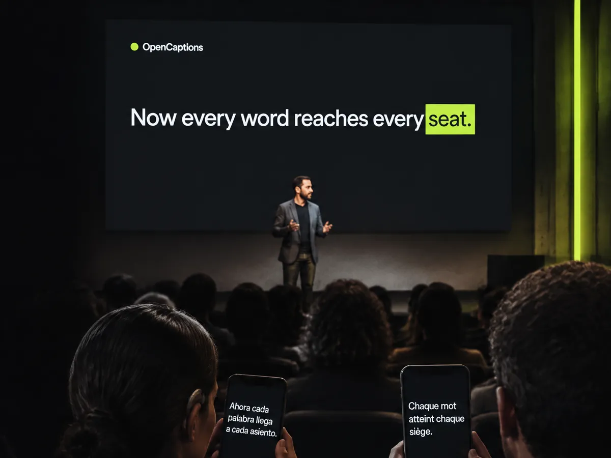
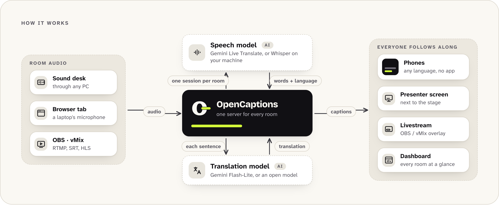
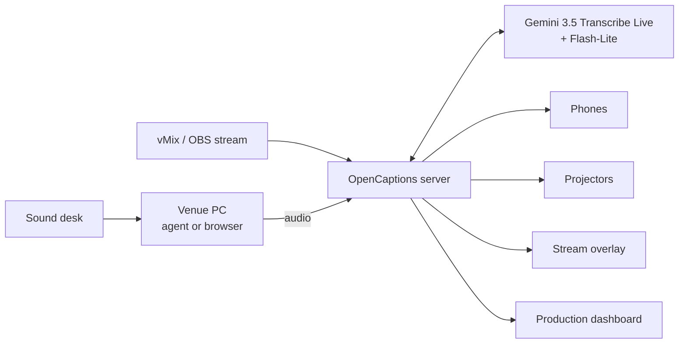

# Project overview

OpenCaptions is open-source software (MIT license) that captions and translates talks live, at any event: one room or many at the same time. This page is the one-page summary for organizers, sponsors, judges and new contributors. For hands-on steps, start with [Getting started](getting-started.md).

## The problem

At conferences, universities, public meetings and festivals, sessions often run in parallel across several rooms and in more than one language. People who don't speak the talk's language, who are deaf or hard of hearing, or who watch the stream remotely miss content.

Commercial captioning services are priced per room and per hour, and they are closed. They're also hard to connect to the setup venues already use: a sound desk, a mini PC per room, projectors, and vMix for the stream.

## The solution

| For | What they get |
|---|---|
| **Audience** | Scan a QR code, pick the room and language, and read live captions on the phone, with the speaker's name when the crew sets it. See each slide on the phone, its text translated. Tap **What did I miss?** for a summary in your language, or **ask the talk** a question. Listen to a translated voice when the organizer turns it on, or, with hearing aids or earbuds, to the room's own sound. Afterwards, read, search and download every transcript. |
| **Room screens** | Large, high-contrast captions on the projector, in the translation and the original, with the QR code. |
| **Stream viewers** | Captions burned into the vMix or OBS stream through a transparent overlay. |
| **Production team** | One dashboard for every room: a getting-started checklist, status, audio level, latency, cost, alerts and transcripts. Paste the agenda once and talks name themselves; a talk running over is flagged with a one-click start for the next. Volunteers get a crew sign-in with the live controls only, and alerts reach the organizers' phones. Settings open in one window with a search box; each room's settings in a side panel. Every organizer page has the same sidebar (rooms listed with a live dot, collapsible to icons), a back button and a breadcrumb, and ⌘K / Ctrl+K to jump to any room, page or setting. |
| **Anyone, on their own computer** | **Just for me**: three short steps the first time (the AI, a language, the sound, with a level meter), then a page that is only the captions, with a slim bar and a floating window. Private, never public. [Just for me](personal.md). |
| **Organizers** | A Mac app, a Windows launcher or Docker, and a welcome wizard that connects the AI and creates a public address. Printable QR posters per room, Event mode with undo, SRT, VTT and TXT transcripts per talk (or all of them in one .zip), recordings captioned in minutes, and an event report with each talk's audience and cost. |

It runs unattended. Each room pauses itself when there's silence (nothing is billed then), resumes when someone speaks, splits transcripts per talk and reconnects by itself.

## How it works

<picture>
  <source media="(prefers-color-scheme: dark)" srcset="images/diagrams/how-it-works-dark.png" />
  
</picture>

Text version of this diagram

1. Each room's audio reaches the server in one of three ways: the headless agent on the venue PC, a browser page, or the stream vMix or OBS already produces.
2. **Gemini 3.5 Transcribe Live** (the default speech model; **Live Translate** when a translated voice is on) transcribes the speech in real time, and OpenCaptions tells the language from the words.
3. **Gemini Flash-Lite** translates each sentence, using the talk's context and a technical glossary. Organizers can pick another AI for this instead (OpenAI, OpenRouter, Groq, Mistral or any OpenAI-compatible service). A provisional translation of the sentence in progress is shown while the speaker is still talking.
4. The server sends captions to every screen over WebSockets.
5. On request, the same text model reads the transcript to answer *What did I miss?* and questions from the audience — grounded only in what was said, cached and rate-limited.

The design details are in [Architecture](architecture.md), and the reasons behind each choice are in the [decision records](adr/README.md).

## Key numbers

| Metric | Value |
|---|---|
| Delay to original-language captions | first words about 1 s after they're said, the finished sentence about 3 s (measured) |
| Delay to translated captions | about 3–6 s (measured, with streaming translation) |
| Rooms per server | Dozens. Tested with 30 simultaneous rooms on one laptop; 3 rooms with 150 phones used 4 % CPU and 124 MB of memory. The limit is the Gemini quota. |
| Cost | about US$ 0.54 per room-hour of speech (US$ 2.2 with a translated voice in headphones), plus US$ 0.4–0.6 per extra language. A 40-minute English → Spanish talk costs about US$ 0.70. |
| Languages | 82 caption languages, in any pair Gemini supports; the setup wizard suggests Spanish, English and Portuguese. |
| Runtime dependencies | 7 npm packages, no build step, no database |

## What makes it different

- **It fits the existing venue setup.** The same cable from the sound desk and the same mini PC; vMix keeps working as it does.
- **One model session per room, whatever the number of languages.** Translation is a cheap text request per sentence, so cost and delay stay bounded.
- **Help for people, not just captions.** Latecomers catch up with a summary in their own language, anyone can ask what was said, and every talk leaves a searchable transcript.
- **Built for operations.** Silence gating, automatic reconnection with no lost audio, watchdogs, an offline backup, alerts on the organizers' phones, and a runbook for the crew.
- **Secure by default.** Sign-in for everything except the public caption pages (admin and crew roles, two-factor codes, company sign-in), a strict Content-Security-Policy, SSRF-safe stream pulls, and no audio stored. An enterprise path runs through Google Cloud Vertex AI.
- **Open and forkable.** MIT license, plain JavaScript, documented APIs, and a pluggable engine interface.
- **Cloud or local.** Gemini for the best quality at scale, or [local mode](local.md), where Whisper and an open model run on your own computer, with no account, no cost per hour and no audio leaving the building. On a Mac with macOS 26 or later, local mode uses Apple's own speech recognition and translation instead: nothing big to download. Without a key, or when a free key runs out, one button in the app sets it up: no terminal.

## Status and maturity

| Area | Status |
|---|---|
| Captions and translation with real talks | Working and measured, with the real model and real conference videos |
| Multi-room operation | Tested with 30 simultaneous rooms playing real talks through Gemini on one laptop (29 streamed; YouTube refused one video). See [Latency](latency.md#measured-numbers). |
| Security baseline | Implemented and covered by unit tests. See [known gaps](security-guide.md#known-gaps). |
| Audience assistant, transcript pages, agenda, QR kit | Implemented; summaries and answers tested end to end with a recorded real-model session |
| Event-day rehearsal | 8 minutes with the real model: 3 rooms, 150 phones (30 over the internet through Cloudflare), a talk running over, a room losing its audio, speaker changes. Every phone got captions, every alert arrived on time, no errors. |
| Platforms | macOS tested end to end, including the Mac app; Linux tested in CI and in Docker; Windows tested by hand and in CI ([Requirements](requirements.md#support-levels)) |
| AI assistants (MCP) | Implemented and tested with the official MCP client: read-only tools for rooms, talks, transcripts, search and the report ([Integrations](integrations.md#use-it-from-an-ai-assistant-mcp)) |
| Vertex AI backend | Implemented, not yet tested end to end |
| Caption a recording | Implemented; a 58-second talk takes about 20 seconds in local mode on a MacBook Pro (M3 Pro); not yet measured with Gemini ([Caption a recording](recording.md)) |
| Local mode on a Mac (Apple's speech recognition and translation) | Implemented, the default on Macs with Apple chips and macOS 26+; measured on a MacBook Pro M3 Pro against Whisper: about as accurate, first words sooner, about 60 times less processor time, no download. One room measured ([Local mode](local.md#apples-speech-recognition-compared-with-whisper)) |
| Local mode (Whisper + Ollama) | Implemented, also from a button in the app (captions about a minute after the click on a MacBook Pro M3 Pro; translations about 5½ more minutes the first time, while the 3.1 GB model downloads); measured on CPUs with the bundled speech server (one room). GPU and Neural Engine backends, and several rooms per machine, not measured yet ([Local mode](local.md#measured-results)) |
| Automated tests | About 300 tests on Linux, macOS and Windows: captions, exports, live corrections, breaks, recordings, restarts, sign-in and roles, security rules, alerts, reconnection edge cases, the assistant, the agenda, AI assistants over MCP, local mode, and an end-to-end test that replays a recorded Gemini session. Every page is checked against WCAG 2.2 AA (`npm run a11y`). `npm run local -- --check` tests local models end to end. |
| Version | 0.9.4. Changes, and anything breaking, are listed in the [changelog](../CHANGELOG.md); [upgrade notes](upgrading.md). |

## Roadmap

1. **Signed apps and more ways to install:** sign the Mac app and Windows launcher (no first-launch warning), `npx opencaptions`, a Homebrew tap and a winget entry.
2. **Closed captions inside the video stream** (CEA-608/708) for broadcasters and YouTube Live.
3. **Telling voices apart** automatically, so transcripts can say who said what without an agenda.
4. **Local mode:** closer to the cloud's delay on computers other than Macs (today about 5–10 s behind it on a laptop's processor; on a Mac, Apple's speech shows first words in about 1 s), measure several rooms per machine, and a local translated voice on computers other than Macs.

## New in 0.9.2

- Every computer needs a Node.js with the October 2026 security fixes; the apps get one by themselves.
- The Mac and Windows apps update themselves from their menu (**Check for Updates…**).
- Original captions without glued words or stray capitals.
- Talks over loud music are captioned instead of paused.
- A room can list the languages its talks can be in, so automatic detection chooses only among them.

Every version's changes are in the [changelog](../CHANGELOG.md).

## License

OpenCaptions is released under the [MIT license](../LICENSE): free for any event, commercial or not. Contributions are welcome: see [CONTRIBUTING.md](../.github/CONTRIBUTING.md).

## Glossary

The full list, with the words to avoid, is in [GLOSSARY.md](../GLOSSARY.md).

| Term | Meaning |
|---|---|
| Room / stage | A physical room or track. `stage` is the identifier used in URLs and the API. |
| Talk | One continuous session in a room. Transcripts are stored per talk. Titles come from the agenda or the dashboard. |
| Assistant | The *What did I miss?* summary and *Ask the talk* feature |
| Ingest | Sending a room's audio to the server |
| Agent | The headless program on a venue PC that captures the sound card and sends it |
| Pull | The server fetching a room's audio from a stream (SRT, RTMP, HLS) |
| Partial / final caption | Text still being refined / text that won't change |
| Silence gate | Pausing audio to the model during silence, to save cost |
