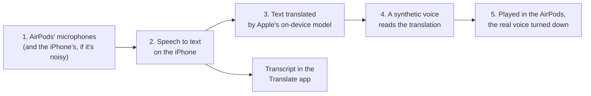

# How Apple's Live Translation works

*Research note, October 2026. Written for OpenCaptions' local mode, which now uses the same Apple building blocks on a Mac ([Local mode](../local.md#on-a-mac-apples-speech-recognition-and-translation)).*

**The short answer.** When you use Live Translation with AirPods, the AirPods only listen and play sound. Your iPhone does the work, without the internet: it turns the other person's speech into text, translates the text with Apple's own AI model, and reads the translation into your ears with a synthetic voice, while noise cancellation turns the real voice down. The internet is needed once, to download the languages.

Every claim below is marked:

- **Apple says**: written on an Apple page (linked);
- **Shown**: we saw it ourselves on a Mac (MacBook Pro, Apple M3 Pro, macOS 27.0.1, Swift 6.4), with the command and its output;
- **Inferred**: our conclusion from the evidence, not stated by Apple.

How we looked: Apple's public pages, Apple's developer documentation and talks, and what a Mac shows to any program that uses Apple's public tools (the interfaces in the developer kit, the system log, and what the tools answer). We did **not** take Apple's programs apart (decompiling, reverse-engineering tools such as REA): Apple's license forbids it, and the public tools answered every question we had, with something we can actually ship.

## The pipeline in five steps



| Step | What happens | Evidence | |
|---|---|---|---|
| 1. Sound in | The AirPods' microphones pick up the other person. In a noisy place, the iPhone's microphones can be used as well. | [Apple Support: Use Live Translation with your AirPods](https://support.apple.com/en-us/123185) | Apple says |
| 2. Speech to text | Done on the iPhone, not in the cloud. | [Apple Support 123185](https://support.apple.com/en-us/123185) says all processing happens on the iPhone once the languages are downloaded; [Apple Support 123720](https://support.apple.com/en-us/123720) says Live Translation runs entirely on device. | Apple says |
| | It's probably the same recognizer that apps get as **SpeechAnalyzer**. | Apple says SpeechAnalyzer already powers Notes, Voice Memos, Journal "and more", and is built for long, distant speech such as lectures and conversations ([WWDC25 session 277](https://developer.apple.com/videos/play/wwdc2025/277/)). Apple doesn't name Live Translation as one of its users. | Inferred |
| 3. Translation | Done on the device by a generative AI model. | [Apple Support 123720](https://support.apple.com/en-us/123720): Apple Intelligence uses generative models, so check important information. On this Mac, the system log of a translation names the model and the engine (below). | Apple says + Shown |
| | The model is Apple Intelligence's on-device language model (about 3 billion parameters) with a small add-on trained for translation. This is also why Live Translation needs an iPhone that runs Apple Intelligence (iPhone 15 Pro or later). | The log names `com.apple.fm.language.instruct_3b.machine_translation` and finishes with `Translation completed using engine: ai-ifp-lora` (a *LoRA* is a small add-on that tunes a big model for one job). Requirements: [Apple Support 123185](https://support.apple.com/en-us/123185). | Shown + Inferred |
| 4. Voice | The translation is spoken in your language. | [Apple Support 123185](https://support.apple.com/en-us/123185) (AirPods translate what the person says into your language); on phone calls the other person hears a spoken translation ([Apple Support 123720](https://support.apple.com/en-us/123720)). | Apple says |
| | The voice is synthesized on the device by Apple's text-to-speech. | Apple doesn't say which voice engine. This Mac has Apple's speech-synthesis frameworks (`SiriTTS`, `TextToSpeech`, below). | Inferred |
| 5. Hearing it | Active Noise Cancellation lowers the volume of the person speaking, so the translation is easier to follow. | [Apple Newsroom, September 2025](https://www.apple.com/newsroom/2025/09/new-apple-intelligence-features-are-available-today/) | Apple says |
| Transcript | The Translate app's Live tab shows the conversation as text, also to show to the other person. | [Apple Support 123185](https://support.apple.com/en-us/123185) | Apple says |

Languages at launch (beta): English (US, UK), French, German, Portuguese (Brazil) and Spanish (Spain), with Italian, Japanese and Korean announced next ([Apple Newsroom, September 2025](https://www.apple.com/newsroom/2025/09/new-apple-intelligence-features-are-available-today/)).

## On the device, or in the cloud?

| | Where | Evidence | |
|---|---|---|---|
| Downloading each language | Internet, once | [Apple Support 123185](https://support.apple.com/en-us/123185) (download the other person's language first); WWDC25 session 277: transcription is on device, but its models are fetched. On this Mac, Spanish speech was downloaded by the system the first time we used it (`downloading Apple's speech model for es-ES (once)`). | Apple says + Shown |
| Speech to text | Device | [Apple Support 123720](https://support.apple.com/en-us/123720); on this Mac it runs in the `localspeechrecognition` service, whose log says `On-Device ASR`. | Apple says + Shown |
| Translation | Device | Apple's developer documentation for `TranslationSession` says all its translations are processed on the device ([TranslationSession](https://developer.apple.com/documentation/translation/translationsession)); the log says `Creating offline engine`. | Apple says + Shown |
| What Apple collects | Usage numbers, not your words | The same page: Apple may collect usage and performance metrics (app, languages) but not the original or translated text. | Apple says |
| A caveat on the Mac | Apple's **Translate app** on a Mac may use Apple's servers unless *On-Device Mode* is on. That's the app, not the developer framework. | [Apple Support: Translate text on Mac](https://support.apple.com/guide/mac-help/translate-text-on-mac-mchldd8b3c15/mac) | Apple says |
| Network check | While both services were running, neither had an internet connection open | `lsof -i` on `localspeechrecognition` and `translationd`: no sockets. A snapshot of one moment only: weak evidence. | Shown |

## What this Mac shows

**The services that do the work.** Apps don't do the recognition and translation themselves: they talk to two system services.

```
$ ls /System/Library/Frameworks/Speech.framework/Versions/A/XPCServices/
localspeechrecognition.xpc
$ ls /System/Library/Frameworks/Translation.framework/
Resources  Translation  Versions  translationd
$ ls /System/Library/PrivateFrameworks | grep -i -E "speech|translat|tts"
… CoreSpeech.framework  LiveSpeechServices.framework  SiriTTS.framework  SpeechTranslation.framework  TextToSpeech.framework …
```

The models live in system folders that even an administrator's programs can't list: `ls /System/Library/AssetsV2/com_apple_MobileAsset_UAF_FM_GenerativeModels` answers `Operation not permitted`. Their names are visible: `com_apple_MobileAsset_UAF_Speech_AutomaticSpeechRecognition`, `com_apple_MobileAsset_UAF_Translation_Assets`, `com_apple_MobileAsset_SpeechTranslationAssets7`.

**The public interfaces.** The developer kit's interface files (`$(xcrun --show-sdk-path)/System/Library/Frameworks/Speech.framework/…/arm64e-apple-macos.swiftinterface`, and the same for `Translation.framework`) list what any app can use:

```swift
@available(anyAppleOS 26, *)
final public actor SpeechAnalyzer { … func start(inputSequence:) … func finalize(through: CMTime?) … }
final public class SpeechTranscriber { … enum ReportingOption { case volatileResults, alternativeTranscriptions, fastResults } … }
final public class AssetInventory { … static func assetInstallationRequest(supporting:) … }
// Translation.framework
@available(iOS 26.0, macOS 26.0, *)
convenience public init(installedSource source: Locale.Language, target: Locale.Language?)
public struct Strategy { public static let highFidelity … public static let lowLatency … }
```

`init(installedSource:target:)` is what makes our feature possible: before macOS 26, a translation session could only be obtained through a window of an app (WWDC24's [Meet the Translation API](https://developer.apple.com/videos/play/wwdc2024/10117/) ties each session to a view). Apple's documentation now describes it for "contexts where there's no UI", for languages already installed ([TranslationSession](https://developer.apple.com/documentation/translation/translationsession)). A command-line program on this Mac used it with no window and no permission prompt:

```
$ opencaptions-apple translate   (one sentence per line in, JSON out)
{"id":1,"text":"Quizás el atacante esté observando el destino."}
```

Speech recognition through `SpeechAnalyzer` didn't ask for permission either (`SFSpeechRecognizer.authorizationStatus()` stayed at 0, "not determined"); the older `SFSpeechRecognizer` does need it.

**Which languages.** Asked through the same public interfaces (`opencaptions-apple check`, our helper, [`src/local/apple.swift`](../../src/local/apple.swift)):

- speech recognition knows 45 regional variants of about 25 languages: `bn de en es fr gu hi it ja kn ko ks mai ml mr mul ne or pa pt ta te ur yue zh`; English (9 variants) was installed, Spanish downloaded on first use;
- translation knows 47 regional variants of 25 languages (`ar da de en es fi fr he hi id it ja ko ms nb nl pl pt ru sv th tr uk vi zh`); English to Spanish, French, Portuguese, German and Japanese reported `installed`.

**The system log while a translation runs** (`/usr/bin/log stream --style compact --level info --predicate 'process == "translationd" OR subsystem BEGINSWITH "com.apple.Translation"'`; in zsh, `log` alone is a different built-in command). Lines picked from 658, in order:

```
[com.apple.Translation:TextAPI] App is linked on or after 26.4, so defaulting to high fidelity strategy
[com.apple.Translation:AIAssetObservation] LLM translation installed [true]
[com.apple.Translation:TranslationEngine] Creating offline engine
[com.apple.ModelCatalog:XPC] requesting resource bundle container for com.apple.fm.language.instruct_3b.machine_translation
[com.apple.Translation.Inference:Adapter] Creating TokenGenerator with use case: speech - on behalf of PID: 77387
[com.apple.Translation:TranslationEngine] Using adapter engine instead of offline engine because preferences are to prefer the adapter engine
[com.apple.Translation:TranslationEngine] Translation completed using engine: ai-ifp-lora
```

What it tells us: the default ("high fidelity") translation is the on-device language model with a translation add-on, not the older dedicated translation models. Asking for the other strategy, `lowLatency`, failed with `TranslationError … notInstalled`: on this Mac only the AI model was there. *Use case: speech* suggests the same path serves spoken-language translation (Inferred).

**The system log while speech is recognized** (`… --predicate 'process == "localspeechrecognition" OR subsystem BEGINSWITH "com.apple.speech"'`):

```
[com.apple.speech.localspeechrecognition:xpcservice] Process start to XPC connection ready in 22.000250 ms
[com.apple.speech.localspeechrecognition:SpeechFramework] Received update for GeneralASR assets, available languages: <private>
[com.apple.speech.localspeechrecognition:SpeechFramework] Transcriber initialized with locale: <private>, effective language: <private>
[com.apple.speech.localspeechrecognition:SpeechFramework] SpeechRecognizerWorker: Getting EARSpeechRecognizer
[com.apple.speech.localspeechrecognition:SpeechFramework] +[SFUtilities cooldownTimerTimeoutSeconds] On-Device ASR: Cooldown scheduled for 120s.
```

**How the words arrive.** SpeechAnalyzer gives two kinds of results, as Apple's talk explains: quick rough ones while you speak (*volatile*), replaced by a final one when it's sure ([WWDC25 session 277](https://developer.apple.com/videos/play/wwdc2025/277/)). We saw the rough ones grow a word or two at a time, about once a second, and the final text for a sentence about 0.9 s after the sentence ended. One surprise: on a fast, evenly paced speaker, Apple kept up to 22 seconds of words provisional before settling them, so OpenCaptions commits a finished sentence itself once two updates agree on it.

## What we built from it

OpenCaptions' local mode on a Mac now follows the same pipeline, minus the earbuds:

| Live Translation (AirPods) | OpenCaptions on a Mac |
|---|---|
| AirPods' microphones | The room's sound (mixer, microphone or stream) |
| On-device speech to text | Apple's SpeechAnalyzer, through a small helper program |
| On-device translation | Apple's Translation framework, same model (the log shows `ai-ifp-lora`) |
| Synthetic voice in the ear | Apple's speech synthesis on the Mac reads each translated sentence; phones play it when people tap 🎧 |
| The real voice turned down | Not needed: it's captions on screens and phones |

Measured on this Mac against the bundled Whisper `small` ([full table](../local.md#apples-speech-recognition-compared-with-whisper)):

| | Whisper `small` (CPU) | Apple |
|---|---|---|
| Words wrong, scripted samples | 0–1.4 % | 1.1–3.1 % |
| Words different from Gemini, a real 3-minute talk | 2.4 % | 2.5–3.4 % |
| First words after someone starts talking (median) | about 1.7 s | about 1.1 s |
| Processor time per minute of speech | about 4 minutes | about 4 seconds |
| Download | about 670 MB | none for the Mac's language |
| Translation per sentence | 0.6–0.8 s (gemma3:4b) | 0.4–0.7 s |

Apple's speech recognition is now the default for local mode on Macs with Apple chips and macOS 26 or later.

## Open questions

- Which voice Live Translation uses, and whether it imitates the speaker. Apple doesn't say. (Inferred: a standard on-device voice.)
- Whether AirPods' Live Translation uses the "low latency" or the "high fidelity" translation. The developer default is high fidelity; we couldn't see the iPhone's choice from a Mac.
- How many rooms one Mac can caption at once with Apple's recognizer. Apple limits simultaneous analyses by hardware ([SpeechAnalyzer documentation](https://developer.apple.com/documentation/speech/speechanalyzer)); not measured yet.

## Sources

- Apple Support: [Use Live Translation with your AirPods](https://support.apple.com/en-us/123185)
- Apple Support: [Use Live Translation on iPhone](https://support.apple.com/en-us/123720)
- Apple Support: [Translate text on Mac](https://support.apple.com/guide/mac-help/translate-text-on-mac-mchldd8b3c15/mac)
- Apple Newsroom: [New Apple Intelligence features are available today](https://www.apple.com/newsroom/2025/09/new-apple-intelligence-features-are-available-today/) (September 2025)
- WWDC25: [Bring advanced speech-to-text to your app with SpeechAnalyzer](https://developer.apple.com/videos/play/wwdc2025/277/)
- WWDC24: [Meet the Translation API](https://developer.apple.com/videos/play/wwdc2024/10117/)
- Apple Developer Documentation: [SpeechAnalyzer](https://developer.apple.com/documentation/speech/speechanalyzer), [TranslationSession](https://developer.apple.com/documentation/translation/translationsession)
- This Mac: the macOS SDK's `Speech` and `Translation` `.swiftinterface` files, `/usr/bin/log stream`, `lsof`, and OpenCaptions' helper ([`src/local/apple.swift`](../../src/local/apple.swift)).
